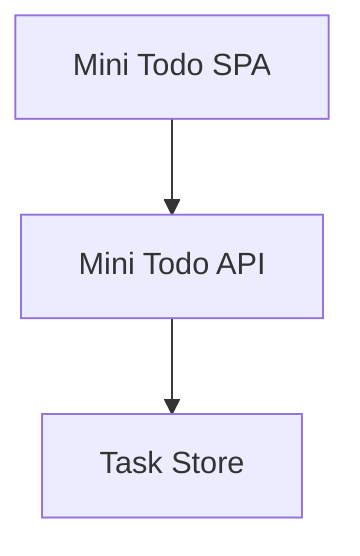
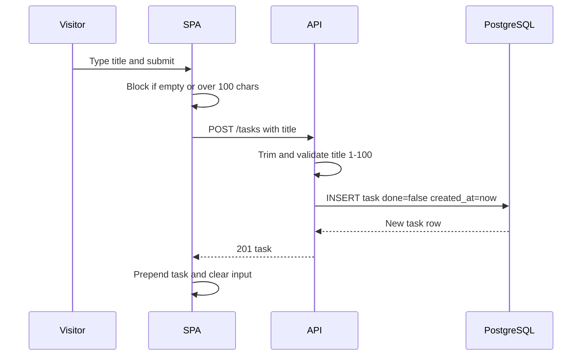
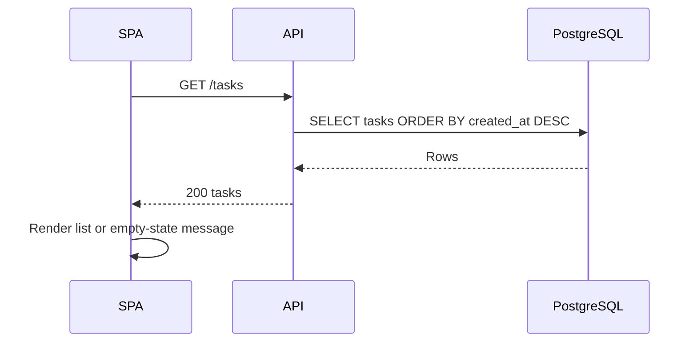
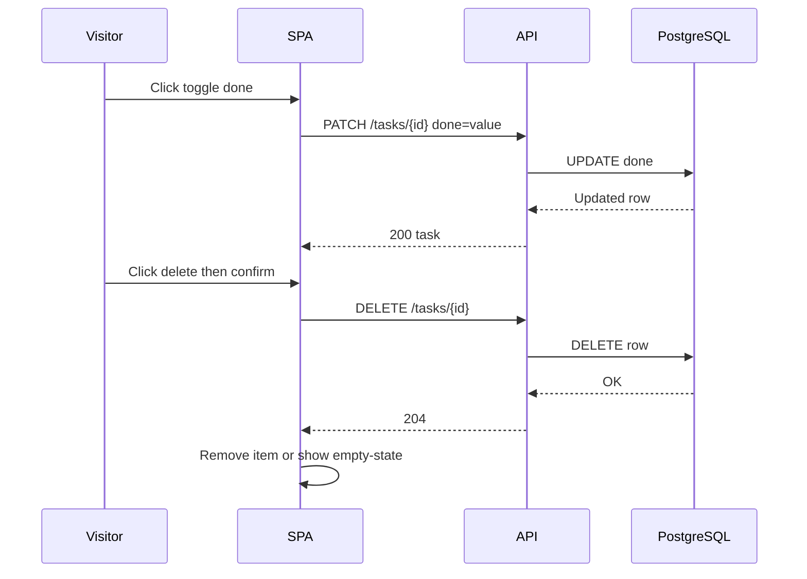
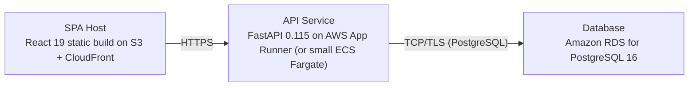

# Architecture

> Maintained by QuorQ AI SDLC. Text between `sdlc:auto` markers is regenerated; anything outside them is yours and is kept.

<!-- sdlc:auto:start narrative -->
## Overview

### ARCH-WEB · approved · source: architecture:web

Mini Todo SPA built in React 19: a single screen for adding, viewing, toggling, and deleting tasks in a shared list, with no sign-in.

Single-screen React app providing: an add-task input enforcing the 100-character limit and showing a required-title message; a newest-first task list with an empty-state message when no tasks exist; a toggle-done control; and a confirm-then-delete control. Reads the API base URL from the VITE_API_BASE_URL environment variable and sends plain unauthenticated requests to the API.

### ARCH-API · approved · source: architecture:api

Mini Todo API built in FastAPI 0.115 exposing list, create, toggle-done and delete endpoints for the shared task list, anonymous and unauthenticated.

FastAPI service validates the title rule (non-empty after trim, max 100 characters) in a single place and returns tasks newest-first. No authentication is implemented; all access is anonymous.

### ARCH-DB · approved · source: architecture:db

Task Store on PostgreSQL 16 holding the single shared tasks table so the list persists across sessions and devices.

Stores title, done flag, and created_at for each task. Sorts newest-first by creation time. One shared global table, no per-user partitioning since there is no sign-in.

### ARCH-CP-ADD · approved · source: architecture:critical-path:Add a task and see it on top

Critical path for adding a task: visitor submits a title, API validates and timestamps it, and the SPA shows it at the top with the input cleared.

Visitor enters a title (1-100 chars) and submits. The API trims and validates the title, creates a not-done task with a creation timestamp, and the SPA shows it at the top of the list with the input field cleared. Empty or whitespace-only titles are rejected with a required-title message shown in the SPA.

**Related:** ARCH-WEB, ARCH-API, ARCH-DB

### ARCH-CP-VIEW · approved · source: architecture:critical-path:View shared list newest-first

Critical path for viewing the shared list: on open, the SPA fetches all tasks and renders them newest-first, with an empty-state fallback.

On open, the SPA requests all tasks from the API and renders them newest-first. Done tasks are shown struck-through in their existing position in the list. When no tasks exist, the SPA shows an empty-state message instead of a list.

**Related:** ARCH-WEB, ARCH-API

### ARCH-CP-TOGGLE-DELETE · approved · source: architecture:critical-path:Toggle done and delete with confirm

Critical path for toggling done status and deleting a task after confirmation, including behavior when the confirm is cancelled or the last task is removed.

Visitor toggles a task's done status, which is reversible and keeps the task in its current list position, or deletes a task after confirming. A cancelled confirm leaves the task unchanged. Deleting the last remaining task results in the SPA showing the empty-state message.

**Related:** ARCH-WEB, ARCH-API

### ARCH-DATA-TASKS · approved · source: architecture:entities:tasks

Single data entity for the whole app: a task record with id, title, done flag, and creation timestamp.

The tasks entity has fields: id, title, done, created_at. This is the only entity in the system, stored in a single shared table with no per-user segmentation (no sign-in).

### ARCH-EP-LIST · approved · source: architecture:endpoints:GET /tasks

GET /tasks returns the full shared task list, newest-first, for the SPA's main view.

Returns all tasks on the shared list ordered newest-first by creation time. Returns an empty array when no tasks exist, which the SPA uses to render its empty-state message.

**Related:** ARCH-CP-VIEW, ARCH-API

### ARCH-EP-CREATE · approved · source: architecture:endpoints:POST /tasks

POST /tasks creates a new task after validating and trimming its title.

Creates a task with a required title (1-100 characters after trimming whitespace), sets it as not-done, and timestamps it with the current time. Title validation is enforced once, in this endpoint's handling, via Pydantic.

**Related:** ARCH-CP-ADD, ARCH-API

### ARCH-EP-TOGGLE · approved · source: architecture:endpoints:PATCH /tasks/{id}

PATCH /tasks/{id} toggles or sets a task's done status without moving it in the list.

Reversible operation: flips (or sets) the done flag for the given task id. The task stays in its existing position in the list; only its done flag and the SPA's strike-through rendering change.

**Related:** ARCH-CP-TOGGLE-DELETE, ARCH-API

### ARCH-EP-DELETE · approved · source: architecture:endpoints:DELETE /tasks/{id}

DELETE /tasks/{id} permanently removes a task from the shared list; the SPA is responsible for confirming with the user first.

Permanently removes the specified task from the shared list. The architecture specifies that confirmation of the delete action is handled client-side in the SPA before this endpoint is called -- the endpoint itself performs the deletion unconditionally once invoked.

**Related:** ARCH-CP-TOGGLE-DELETE, ARCH-API

### ARCH-DEPLOY-WEB · approved · source: architecture:deployment-node:SPA Host

SPA is deployed as a static Vite build hosted on S3 behind CloudFront.

React 19 static build (Vite output) served as static assets from S3 with CloudFront as the CDN/edge layer.

**Related:** ARCH-WEB

### ARCH-DEPLOY-API · approved · source: architecture:deployment-node:API Service

API is deployed as a containerized FastAPI service on AWS App Runner (or small ECS Fargate).

FastAPI 0.115 running under Python 3.12 with Uvicorn, packaged as a container, deployed to AWS App Runner (or a small ECS Fargate service as an alternative noted in the input).

**Related:** ARCH-API

### ARCH-DEPLOY-DB · approved · source: architecture:deployment-node:Database

Database is deployed as a small Amazon RDS for PostgreSQL 16 instance.

Amazon RDS for PostgreSQL 16 on a db.t4g.micro instance size, sized for the small, inexpensive setup described for this project.

**Related:** ARCH-DB

### ARCH-TECH-FRONTEND · approved · source: architecture:technology-decision:Frontend

Approved frontend stack is React 19, chosen over Vue and Svelte, built with Vite.

React 19 renders the single live-updating list cleanly as tasks are added, toggled, and removed, and shows the empty-state when none remain. Built with Vite and served as static assets; reads the API base URL from the VITE_API_BASE_URL environment variable. Alternatives considered: Vue, Svelte.

**Related:** ARCH-WEB

### ARCH-TECH-BACKEND · approved · source: architecture:technology-decision:Backend

Approved backend stack is FastAPI 0.115, chosen over Flask and Express.

Four small endpoints with the 1-100 character title rule enforced once via Pydantic validation, sized to fit the two-sprint plan. Alternatives considered: Flask, Express.

**Related:** ARCH-API

### ARCH-TECH-DB · approved · source: architecture:technology-decision:Database

Approved database is PostgreSQL 16, chosen over SQLite and DynamoDB.

A single tasks table persists the shared list server-side across sessions and devices and sorts newest-first by created_at with no extra effort. Alternatives considered: SQLite, DynamoDB.

**Related:** ARCH-DB

### ARCH-TECH-CLOUD · approved · source: architecture:technology-decision:Cloud

Approved cloud provider is AWS, chosen over GCP and Azure.

Hosts the small API (App Runner) and the shared database (RDS PostgreSQL 16) plus the static SPA (S3/CloudFront) in a small, inexpensive setup that keeps the list reachable, noted as addressing NFR-002.

**Related:** ARCH-DEPLOY-WEB, ARCH-DEPLOY-API, ARCH-DEPLOY-DB
<!-- sdlc:auto:end narrative -->

<!-- sdlc:auto:start building-blocks -->
## Building Block View

| ID | Name | Technology | Responsibility | Depends on |
|---|---|---|---|---|
| web | Mini Todo SPA | React 19 | Single-screen React app: add-task input with 100-char enforcement and required-title message, newest-first list with empty-state, toggle-done control and confirm-then-delete. Reads API base URL from VITE_API_BASE_URL and sends plain requests (no auth). | api |
| api | Mini Todo API | FastAPI 0.115 | FastAPI service exposing list, create, toggle-done and delete endpoints. Validates title (non-empty after trim, max 100 chars) in one place and returns tasks newest-first. Anonymous, no authentication. | db |
| db | Task Store | PostgreSQL 16 | Stores the single shared task table (title, done flag, created_at) so the global list persists across sessions and devices, and sorts newest-first by creation time. | — |

<!-- sdlc:auto:end building-blocks -->

<!-- sdlc:auto:start runtime -->
## Runtime View

### Add a task and see it on top

Visitor enters a title (1-100 chars) and submits. The API trims and validates the title, creates a not-done task with a creation timestamp, and the SPA shows it at the top with the input cleared. Empty or whitespace-only titles are rejected with a required-title message.

- **Components:** web, api, db
- **Modules:** web/AddTaskForm, web/api-client, api/routes_tasks, api/schemas, api/repository
- **Key functions:** createTask(title), validate_title(title), create_task(title) -> Task, list_tasks() -> Task[]

### View shared list newest-first

On open, the SPA requests all tasks and renders them newest-first, showing done tasks struck-through in place, or an empty-state message when none exist.

- **Components:** web, api, db
- **Modules:** web/TaskList, web/EmptyState, api/routes_tasks, api/repository
- **Key functions:** listTasks(), list_tasks() -> Task[]

### Toggle done and delete with confirm

Visitor toggles a task's done status (reversible, stays in place) or deletes it after confirming. A cancelled confirm leaves the task unchanged; deleting the last task returns the empty-state.

- **Components:** web, api, db
- **Modules:** web/TaskItem, web/ConfirmDialog, api/routes_tasks, api/repository
- **Key functions:** toggleDone(id), deleteTask(id), set_done(id, done) -> Task, delete_task(id)

<!-- sdlc:auto:end runtime -->

<!-- sdlc:auto:start deployment-view -->
## Deployment View

| Name | Service | Runtime | Scaling | Environment |
|---|---|---|---|---|
| SPA Host | React 19 static build on S3 + CloudFront | Static assets (Vite build) | CDN-served, no app scaling needed | dev |
| API Service | FastAPI 0.115 on AWS App Runner (or small ECS Fargate) | Python 3.12 + Uvicorn container | Single small instance, autoscale 1-2 for light traffic | dev |
| Database | Amazon RDS for PostgreSQL 16 | PostgreSQL 16, db.t4g.micro | Single instance, light load | dev |

| Source | Target | Protocol |
|---|---|---|
| SPA Host | API Service | HTTPS |
| API Service | Database | TCP/TLS (PostgreSQL) |

<!-- sdlc:auto:end deployment-view -->

<!-- sdlc:auto:start decisions -->
## Architecture Decisions

| Layer | Choice | ADR |
|---|---|---|
| Frontend | React 19 | [ADR-0001](adr/frontend.md) |
| Backend | FastAPI 0.115 | [ADR-0002](adr/backend.md) |
| Database | PostgreSQL 16 | [ADR-0003](adr/database.md) |
| Cloud | AWS | [ADR-0004](adr/cloud.md) |
<!-- sdlc:auto:end decisions -->

<!-- sdlc:auto:start links -->
## Related Documents

- [Data Model](data-model.md)
- [API Specification](api/openapi.yaml)
- [Architecture Decision Records](adr/README.md)
<!-- sdlc:auto:end links -->
